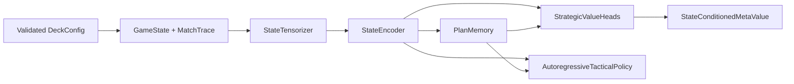

# Phase 1 architecture and extension contracts

Phases 2 and 3 have since implemented the observation/belief and plan-search
seams described here; see `PHASE2_ARCHITECTURE.md` and
`PHASE3_ARCHITECTURE.md`. This document remains the authoritative record of the
Phase 1 boundaries and tensor contracts.

## Data flow

The implementation is intentionally simulator-agnostic. It defines stable data
and neural boundaries without pretending to implement card rules, legal-action
generation, environment transitions, training, beliefs, or search.

## Stable contracts

### Deck configuration

`DeckConfig` validates positive counts, unique names, recognized categories, and
an exact 60-card total. Canonical JSON produces a stable SHA-256 fingerprint.
Experiment artifacts should carry this fingerprint.

### State and history

`GameState` is immutable and contains two `PlayerState` objects, Pokemon in play,
attachments, zones, turn flags, stadium, phase, and winner. `GameAction`,
`TurnRecord`, and `MatchTrace` store ordered history. Stable JSON and state
digests allow trace chaining and corruption detection.

The schema can represent hidden simulator cards with `card_name = null` and
`revealed = false`; it does not assign probabilities. Phase 2 should add a
separate observation/belief layer rather than inserting guesses into simulator
truth.

### Features and encoder

`StateTensorizer` emits `[batch, 37]` float tensors. The names and order are
exported as `STATE_FEATURE_NAMES`. Features cover turn/prize context, hands and
zones, board occupancy and health, attached resources, turn permissions, and
Team Rocket archetype pieces.

This tensorizer is a deterministic baseline, not a claim that handcrafted
features are optimal. A future relational/transformer encoder can be added
behind the same downstream embedding boundary. Tokenized card objects and
history should be introduced as a new version rather than silently changing the
37-feature meaning.

### Persistent plan

`PlanMemory` maps state embeddings plus an optional previous `[batch, plan_dim]`
latent through a recurrent update. `PlanLatent` is the detached, JSON-safe
snapshot for one match/turn. The caller owns persistence: load the previous
snapshot before a decision, pass it into the model, and save the returned plan.
This makes resets and episode boundaries explicit.

Phase 2 can add intent supervision or interpretable plan prototypes without
changing this stateful contract. Search must copy plan tensors per branch rather
than mutating a global latent.

### Strategic values

`StrategicValueHeads` owns six independent neural heads in fixed order:

1. setup;
2. tempo;
3. resource efficiency;
4. prize control;
5. board control; and
6. optionality.

Each emits `[batch, 1]` in `[-1, 1]`. `StateConditionedMetaValue` produces
softmax weights `[batch, 6]` from state and plan embeddings, then returns their
convex combination `[batch, 1]`. Keeping head values and weights in the public
output is required for diagnostics and future search gating.

### Tactical policy

Pokemon actions often require multiple selections. The policy therefore scores
one legal candidate set at a time and advances a recurrent decoder after each
chosen token. `ActionPrefix` records semantic components such as action kind,
source, target, mode, amount, and end. A future simulator adapter implements
`LegalActionProvider`, produces fixed-width candidate features, applies legality
masks, and translates the completed prefix into an environment action.

`NeuralAutoregressiveTacticalPolicy` is a reference implementation, not a legal
action generator. Its tensor contract is:

- initial context: state `[B, E]`, plan `[B, P]` -> hidden `[B, H]`;
- score: hidden `[B, H]`, candidates `[B, N, C]`, legal mask `[B, N]` ->
  logits `[B, N]`;
- advance: hidden `[B, H]`, chosen candidate `[B, C]` -> next hidden `[B, H]`.

At least one candidate per batch row must be legal. Illegal candidates receive
negative-infinity logits before sampling or argmax.

## Deliberate Phase 1 omissions

- Card text, rule resolution, and environment stepping
- Training losses, datasets, replay buffers, checkpoints, and self-play
- Opponent hand/archetype/intent posterior models
- Plan proposal, tree search, determinization, and search gates
- Counterfactual targets and reward shaping
- Kaggle agent I/O and time-budget packaging

## Implemented seams through Phase 4

- **Phase 2 beliefs:** versioned `AgentObservation` and `OpponentBeliefState`
  objects live alongside `GameState`; posterior guesses never overwrite truth.
- **Phase 3 plan search:** `StrategicPlanCandidate`, branch-local plan memory,
  and a rich evaluation object carry all six heads and meta-weights.
- **Phase 4 gating:** `SearchGateFeatureExtractor` consumes policy uncertainty,
  head disagreement, belief entropy, proposal ambiguity, public thresholds, and
  compute without changing the tactical decoder contract.
- **Phase 5 learning:** `SearchTeacherRecord` serializes independently validated
  search improvements with environment/deck/model/search fingerprints, and
  `SearchGuidedDistiller` trains every named target only after admission.

Phase 6 wraps these pieces in competition evaluation and packaging after their
interfaces and evidence stabilize.
