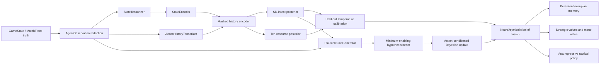

# Phase 2 architecture: strategic intent and hidden-resource beliefs

Phase 3 has since implemented the plan-search seams described at the end of this
document; see `PHASE3_ARCHITECTURE.md`. This document remains authoritative for
the Phase 2 observation, belief, calibration, and inverse-planning contracts.

Phase 2 adds a separate agent-visible observation and belief layer without
changing omniscient simulator truth. It implements two complementary routes:

1. a trainable neural posterior over strategic intent and coarse private
   resources; and
2. an inverse-planning posterior over minimum-enabling resource hypotheses.

Both routes expose stable, serializable distributions. Neither writes inferred
cards into `GameState` or treats a posterior hypothesis as fact.

## Data flow

## Observation boundary and leakage rules

`AgentObservation` is the only Phase 2 input intended for model features.
`redact_state_for_observer` applies these rules:

- both players' deck identities are hidden while counts and instance IDs remain;
- both players' prize identities are hidden;
- the observer's hand is visible and the opponent's hand is hidden;
- in-play cards, attachments, discard, lost zone, and stadium are public;
- an opponent draw removes card name and source/target IDs from public history;
- arbitrary simulator action payloads are never copied into `ObservedAction`.

The resulting object validates that opponent private zones and the observer's
deck/prizes contain no card identities. It has canonical JSON and a SHA-256
digest. An environment adapter remains responsible for marking any additional
effect-specific information as public before constructing an observation.

## Compact opponent intent space

The fixed Phase 2 vocabulary is:

1. setup;
2. prize race;
3. lock/disruption;
4. board denial;
5. resource conservation; and
6. combo assembly.

`OpponentPlanPosterior` is a normalized categorical distribution with entropy,
Bayesian likelihood updates, a most-likely intent, and canonical serialization.
Keeping the full distribution is required; downstream code must not replace it
with only the argmax intent.

## Coarse private-resource space

The ten categories are basic Pokemon, evolution, energy, search, draw,
switch/mobility, recovery, disruption, tool, and stadium. They are deliberately
functional categories rather than named cards, allowing an opponent line to
assert the minimum capabilities it needs without fabricating an exact hand.

`ResourceVector` stores minimum counts. `OpponentBeliefState` exposes marginal
presence probabilities to the learned policy and may also carry the complete
symbolic hypothesis beam for audit and future search.

## Neural belief path

`OpponentBeliefModel` consumes:

- encoded public state `[B, E]`;
- public action history `[B, T, A]`; and
- a Boolean history mask `[B, T]`.

A masked `GRUCell` leaves hidden state unchanged on padded events. The fused
embedding produces:

- plan logits/probabilities `[B, 6]`;
- resource logits/probabilities `[B, 10]`;
- a learned belief embedding; and
- a public context vector `[B, 16]` containing the calibrated distributions.

`BeliefSupervision` pairs a trajectory prefix with an intent label and partial or
complete resource labels learned later from revealed outcomes. Unknown resource
categories have a zero known-mask and contribute no binary loss.
`TrajectoryBeliefDataset`, `BeliefBatchBuilder`, and
`belief_supervision_loss` provide stable serialization, collation, and joint
cross-entropy/binary-cross-entropy supervision.

## Calibration

`BeliefCalibrator.fit` selects separate positive scalar temperatures for plan
and resource logits on held-out data. The deterministic grid always includes
temperature 1.0, so calibration cannot worsen its own held-out NLL objective.
`evaluate_beliefs` reports:

- plan negative log likelihood, multiclass Brier score, accuracy, and expected
  calibration error;
- resource binary cross entropy, Brier score, and threshold accuracy; and
- optional masking so only genuinely revealed resource labels are scored.

Calibration artifacts are JSON serializable. Calibration must be fit on a
validation split and evaluated on a separate test split in real experiments.

## Inverse hidden-information path

`PlausibleLineGenerator` is the environment seam for proposing strong legal
opponent lines. `IntentTemplateLineGenerator` is a rule-agnostic reference used
for deterministic tests; it emits action-category sketches and minimum resource
vectors, not card-legal simulator turns.

`MinimumEnablingHypothesisGenerator` creates a bounded beam containing rational,
imperfect, and deceptive behavior variants for every proposed line, plus an
unmodeled-play floor. This ensures a surprising or mistaken action does not
collapse posterior mass to zero.

For each hidden-resource hypothesis, `InversePlanningBeliefUpdater`:

1. removes lines whose minimum resources are not covered;
2. scores feasible lines by base utility and intent compatibility;
3. converts scores to a style-specific softmax using positive, low, or negative
   rationality;
4. compares predicted and observed action sequences using ordered subsequence
   similarity and a length penalty;
5. mixes a nonzero random-action floor into the likelihood; and
6. applies Bayes reweighting and renormalization.

Later public reveals can condition the beam again with a small observation-error
floor. The updated beam yields plan marginals, resource-presence marginals,
expected resource counts, entropy, and explanatory text.

## Decision conditioning

`Phase2BeliefAwareAgent` uses the calibrated 16-value context in three places:

- a residual state conditioner before persistent plan-memory updates;
- the strategic value heads and state-conditioned meta-value through that
  conditioned state; and
- the tactical policy's initial recurrent context directly.

The agent returns the raw state embedding, conditioned state embedding, complete
belief output, persistent plan, all six strategic values, aggregate value, and
meta-weights. `capture_belief` and `capture_plan` make both persistent states
explicit. Passing an all-zero or uninformed belief vector is the supported
ablation; it should never happen silently.

## Deterministic evidence

`scripts/phase2_demo.py` builds stratified train/validation/test trajectory
fixtures for all six intents, trains the belief model, fits held-out
temperatures, evaluates test calibration, performs inverse action and reveal
updates, round-trips every durable belief object, and trains the tactical policy
on belief-conditioned action choices.

The fixture requires:

- 100% plan and resource accuracy on its intentionally separable held-out set;
- calibrated plan NLL no worse than the uncalibrated result;
- increased basic-Pokemon marginal after an observed setup sequence;
- preservation of rational, imperfect, and deceptive hypotheses; and
- at least 0.50 tactical accuracy improvement over an uninformed belief context.

This proves wiring, trainability, calibration mechanics, and downstream use. It
does **not** establish real Pokemon playing strength; that requires environment
trajectories, opponent diversity, and Phase 6 evaluation.

## Phase 2 boundary and implemented Phase 3 seams

Phase 2 itself does not implement plan proposal or rollouts. Phase 3 now adds
`StrategicPlanCandidate`, a Team Rocket proposer, branch-local latent handling,
full retained-posterior evaluation, autoregressive tactical rollouts, and rich
results preserving beliefs, head values, meta-weights, and uncertainty. A real
competition integration still needs to replace the reference
`StrategicAbstractionAdapter` and intent templates with card-legal transitions
and opponent lines.
