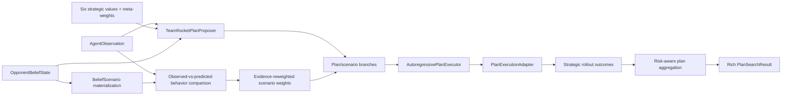

# Phase 3 architecture: belief-aware strategic plan search

Phase 3 searches a few complete strategic lines across the retained Phase 2
belief distribution. It deliberately does not build a raw tree over every card,
target, mode, and ordering. The tactical policy still resolves those low-level
choices, but only while executing a selected high-level line inside a branch.

## Data flow



## Complete strategic plans

`StrategicPlanCandidate` contains:

- a stable plan ID and title;
- a primary strategic objective from the six Phase 1 axes;
- a turn horizon;
- ordered `PlanStep` directives with per-step success conditions;
- a plan-level completion condition and rationale;
- coarse required resources;
- alignment weights for all six strategic values;
- matchup weights for all six opponent intents;
- a normalized proposal prior and its pre-softmax score.

A plan is rejected if it has no steps, duplicate step IDs, a step outside its
horizon, missing six-axis/six-intent vectors, or invalid probability data.

`TeamRocketPlanProposer` currently owns five archetype-aware templates:

1. build the Spidops engine;
2. convert Mewtwo pressure into prizes;
3. disrupt the opponent's assembly line;
4. pivot defensively and preserve the long game; and
5. create a Clefairy counter-tempo pivot.

It scores them from current strategic head values, opponent plan probabilities,
public board cues, and template matchup alignment. It rejects near-duplicate
directive sets, returns only `top_k`, and renormalizes their priors. This makes
proposal useful before a learned proposer exists while retaining a stable
`StrategicPlanProposer` protocol for a later trainable implementation.

## Belief scenarios and behavior evidence

`scenarios_from_belief` converts every retained symbolic hidden-resource
hypothesis into a `BeliefScenario`. With the default 32-scenario budget, the full
Phase 2 beam is searched. If only neural marginals exist, one scenario per intent
is synthesized. Any explicit lower budget uses the highest posterior scenarios
and renormalizes them.

For every searched scenario, `IntentOpponentBehaviorModel` predicts an ordered
public action signature conditioned on intent and rational/imperfect/deceptive
style. `OpponentBehaviorComparator` compares that signature with the latest
observed opponent turn using ordered-subsequence overlap, a length penalty, and
a nonzero likelihood floor. Bayes reweighting produces a scenario posterior that
is retained in `ScenarioEvidence`; no hypothesis is converted into certainty.

## Branch-local autoregressive execution

`PlanExecutionAdapter` is the simulator boundary:

- `start` creates an independent rollout state;
- `next_candidates` returns the next legal tactical tokens for a plan step;
- `commit_action` returns a new branch state after a completed action prefix;
- `evaluate` returns strategic deltas, terminal value, objective achievement,
  predicted opponent response, resource cost, and notes.

`AutoregressivePlanExecutor` clones the persistent plan tensor before each
branch, initializes the tactical policy with state, plan, and the calibrated
16-value belief context, and resolves each directive token by token. Each step
must terminate with `ActionComponent.END` within its token budget. The rollout
retains every selected token, its probability/log probability, policy entropy,
candidate count, completed prefix, and outcome.

Only one linear tactical rollout is followed per plan/scenario pair. The engine
records the product of candidate counts as an estimate of raw action sequences
that an unabstracted search would enumerate; it never expands that product.

## Strategic evaluation and plan selection

For a branch, the adapter's axis deltas are added to the model's six current
head values and clamped to `[-1, 1]`. Learned meta-weights combine those values.
The aggregate branch value blends that strategic estimate with the rollout's
terminal estimate and subtracts bounded resource cost.

For each plan, the scenario posterior produces:

- expected values for all six axes;
- expected aggregate value;
- posterior value standard deviation;
- primary-objective achievement;
- tactical policy confidence and entropy.

The search score is:

```text
expected value
- risk_aversion * scenario value standard deviation
+ objective_weight * objective achievement
+ prior_weight * log(plan prior)
+ policy_confidence_weight * tactical confidence
```

All coefficients are explicit in `PlanSearchConfig`. The plan with maximum
search score is selected; Phase 4 now decides when this expensive calculation
should run.

## Rich search result

`PlanSearchResult` is canonical JSON and validates its invariants. It returns:

- observed opponent action signature;
- chosen plan and objective;
- inferred opponent intent;
- base six-head values, meta-value, and meta-weights;
- the complete `OpponentBeliefState`;
- predicted behavior, likelihood, and posterior for every searched scenario;
- every proposed plan and its prior;
- every plan/scenario tactical rollout and branch value;
- expected values, risk, objective score, confidence, entropy, and search score;
- scenario entropy, proposal entropy, chosen value uncertainty, and plan margin;
- plans/scenarios/branches searched, candidates scored, estimated raw action
  sequences, and estimated branch reduction.

Malformed result artifacts are rejected if probabilities do not normalize,
six-axis vectors are incomplete, the chosen plan is missing, branch counts are
invalid, prefixes are incomplete, or uncertainty contains non-finite values.

## Verification adapter and deterministic evidence

`StrategicAbstractionAdapter` is an immutable, simulator-shaped reference. It
offers multiple action kinds and commitment modes per directive, maps selected
tactics into scenario-sensitive strategic deltas, and exposes future opponent
actions. It is intentionally not a Pokemon card-rules engine.

`scripts/phase3_demo.py` uses an observed combo-assembly turn and a 19-hypothesis
belief beam. The deterministic acceptance checks require:

- four normalized, distinct, complete three-step plans;
- all 19 retained hypotheses searched;
- combo posterior mass to increase after behavior comparison;
- every branch to complete through the autoregressive tactical policy;
- the persistent plan tensor to remain unchanged by branch search;
- Rocket disruption to beat the alternatives under the combo posterior;
- all six values and every rich-result field to serialize and round-trip; and
- estimated raw-branch reduction of at least 50x.

The current deterministic result searches 76 linear plan/scenario branches,
scores 1,596 tactical candidates, estimates 55,404 corresponding raw sequences,
and reports a 729x reduction. These are contract and abstraction measurements,
not claims about card-legal simulator speed or match strength.

## Phase 3 boundary and implemented Phase 4 integration

Phase 3 always searches when invoked. It does not decide whether a position
deserves extra computation. Phase 4 adds a cheap pre-search feature extractor, a
learned and held-out-calibrated gate, an immutable compute bank, and
`SelectiveSearchPolicy`. That wrapper calls `BeliefAwarePlanSearch` only after
the gate predicts value above its calibrated threshold and the bank can afford
the configured cost. A competition adapter must still replace
`StrategicAbstractionAdapter` with card-legal state transitions while preserving
`PlanExecutionAdapter`.
