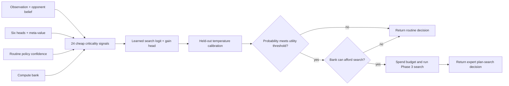

# Phase 4 architecture: calibrated selective expert search

Phase 4 learns when the expensive Phase 3 planner is likely to improve a routine
tactical decision enough to repay its compute cost. It makes two independent
decisions: first, whether search is desirable; second, whether the current
compute bank can afford it. Routine states never enter plan search.

## Decision flow



`SelectiveSearchPolicy` always receives a complete `RoutineDecision`. Its gate
uses only information already available before a rollout. If the gate declines
or the bank is exhausted, the exact routine action prefix and value estimate are
preserved and `BeliefAwarePlanSearch.search` is not called.

## Cheap criticality representation

`SearchGateFeatureExtractor` returns a versioned `SearchGateFeatures` vector of
24 finite values normalized to `[0, 1]`:

| Signal family | Features |
|---|---|
| Routine policy | `policy_uncertainty`, `policy_entropy`, `legal_action_pressure` |
| Strategic values | `head_disagreement`, `head_range`, `meta_value_neutrality` |
| Opponent uncertainty | `plan_belief_entropy`, `resource_belief_entropy`, `hypothesis_entropy` |
| Tactical thresholds | `own_knockout_risk`, `opponent_knockout_opportunity`, `own_prize_closeness`, `opponent_prize_closeness`, `evolution_window`, `disruption_window`, `board_collapse_risk`, `knockout_swing`, `prize_swing` |
| Competing plans | `proposal_ambiguity`, `proposal_entropy`, `objective_diversity`, `optionality_spread` |
| Context | `turn_progress`, `budget_fraction` |

The extractor asks the Phase 3 proposer for at most four cheap candidate plans
but performs no scenario materialization, tactical rollout, or plan search.
Proposal ambiguity measures how close the top priors are; optionality spread
captures cases where similarly plausible plans preserve sharply different
future flexibility. Those priors are a softmax of the Team Rocket proposer's
state-, belief-, and value-conditioned proposal scores, so they provide a cheap
pre-search expected-value proxy rather than pretending full rollout values are
already known.

## Learned value-of-search target

`SearchGateSupervision.from_outcome` creates a matched-root label after both the
routine policy and expert planner have been evaluated:

```text
realized_search_gain = chosen_search_expected_value - routine_value_estimate
should_search = realized_search_gain > measured_search_cost
```

`SearchGateDataset` serializes those versioned examples. `SearchGateNetwork` is
a small MLP with two outputs:

- a binary logit for whether search pays for itself; and
- a regression estimate of the raw value gain from search.

`search_gate_loss` combines binary cross-entropy with a weighted smooth-L1 gain
loss. Both outputs remain available because invocation calibration and value-gain
diagnostics answer different questions.

The deterministic benchmark uses separated train, validation, and test splits.
It includes synthetic examples for every Phase 4 trigger family plus jittered
features extracted from integrated routine and pivotal Team Rocket states. This
proves the learning and orchestration contract; it is not a substitute for
matched outcomes from a card-rules environment.

## Calibration and utility

`SearchGateCalibrator.fit` uses validation data only. It chooses temperature
scaling by minimum binary cross-entropy, then selects the invocation threshold
that maximizes mean realized search gain after cost. Because temperature `1.0`
is always a candidate, fitting cannot select a worse listed temperature than the
uncalibrated baseline on the calibration split.

`evaluate_search_gate` reports accuracy, precision, recall, Brier score,
expected calibration error, total invocation rate, invocation rates separately
for profitable and unprofitable examples, realized net utility, and oracle net
utility. The separate positive and negative invocation rates directly measure
whether compute is concentrated on pivotal decisions rather than merely whether
the dataset is classified accurately.

## Compute accounting and explanations

`SearchComputeBank` is immutable and serializable. It records capacity,
available compute, per-turn refill, and lifetime spend. `spend` and `refill`
return new objects, so every `SearchGateDecision` can retain exact bank state
before and after invocation.

Gate outcomes distinguish:

- `wanted_search`: learned calibrated probability cleared the threshold;
- `should_search`: search was wanted and affordable; and
- `budget_limited`: search was wanted but unavailable.

The gate also records human-readable reasons when explicit signals are high:
low policy confidence, value-head disagreement, high belief entropy, knockout,
prize, evolution, disruption, or board-collapse thresholds, and close plans
with different optionality. These reasons explain the decision but do not
replace the learned probability.

## Durable selective decision

`SelectiveDecision` is canonical JSON with strict invariants:

- `routine_policy` mode cannot carry a search result;
- `expert_search` mode must carry the complete Phase 3 `PlanSearchResult`;
- the mode must agree with the gate outcome; and
- every decision includes its routine alternative, gate features, calibrated
  probability, predicted gain, threshold, reasons, cost, and bank transition.

Phase 5 now consumes this counterfactual context: its trajectory recorder saves
routine and expert decisions together, independently validates their difference,
and derives distillation targets without changing the planner or policy
interfaces.

## Deterministic evidence and boundary

`scripts/phase4_demo.py` trains the gate on 480 examples, calibrates on 110, and
evaluates once on a separate 110-example test split. With seed `20260726`, it
reports 99.1% accuracy, 98.2% invocation on profitable pivotal examples, 0%
invocation on unprofitable routine examples, positive net utility, and 98.2% of
oracle net utility. It then proves that a routine state bypasses search, a
pivotal Team Rocket combo/disruption state invokes the Phase 3 planner exactly
once, and an empty bank blocks that same positive request.

These figures are deterministic contract evidence on synthetic fixtures. They
do not establish card-legal decision quality or tournament strength. Phase 5 now
implements matched teacher collection, validation, distillation, and retention
rechecks over the reference environment contract. Phase 6 must evaluate those
mechanics with card rules, calibrated match outcomes, latency, robustness, and
leaderboard behavior.
