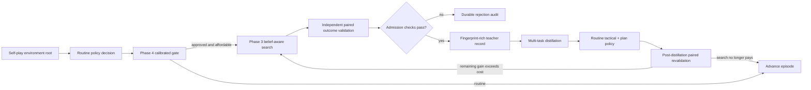

# Phase 5 architecture: validated search-guided learning

Phase 5 converts expensive but reliable Phase 3–4 decisions into durable
training data, then teaches the routine student to reproduce them. Search is not
automatically trusted, and successful distillation does not automatically remove
search. Both transitions require paired outcome evidence.

## End-to-end flow



`SearchGuidedSelfPlayRunner` owns orchestration, not game rules. A
`SearchGuidedSelfPlayEnvironment` supplies each public root, explicit opponent
belief, routine alternative, paired validator, transition, episode ID, and
environment fingerprint. The runner evaluates the current agent, invokes
`SelectiveSearchPolicy`, threads the immutable compute bank through every turn,
and advances the environment whether the decision was routine or searched.

The deterministic reference environment is an episode-shaped strategic paired
replay. It exercises this complete protocol but is not a Pokémon rules engine.

## Two different search costs

Phase 5 separates quantities that should never share a scale:

- `compute_cost` spends units from `SearchComputeBank`; and
- `search_value_cost` is the value-equivalent penalty used to decide whether a
  search improvement pays for itself.

The first constrains available computation. The second supervises search utility.
Every teacher record preserves both.

## Independent admission

`OutcomeValidation` records routine and search returns from the same root,
confidence, paired sample count, complete-horizon or terminal verification,
source, and environment fingerprint. `SearchTeacherCollector` admits a root only
when all configured checks pass:

- selected expert search and public observation refer to the same root;
- the complete search artifact canonical-JSON round-trips;
- predicted and independently validated gains clear meaningful margins;
- validated gain exceeds value-equivalent search cost;
- evidence confidence and paired sample count clear their thresholds;
- the validator attests terminal or complete-horizon evaluation;
- environment fingerprint matches provenance;
- teacher posterior value deviation is bounded;
- the modal tactical sequence is reconstructible from legal adapter candidates;
- that sequence has enough posterior branch consensus;
- search changes the routine action or strategic plan; and
- at least one alternative passes the full counterfactual audit.

Rejected searched roots retain named failed checks in `TeacherAdmission`; they
cannot silently enter the training dataset. `SearchTeacherRecord` independently
revalidates IDs, fingerprints, target values, action/plan-change flags,
counterfactual values, positive net utility, and admission checks while loading.

## Durable teacher target

Each admitted record contains:

| Target family | Source |
|---|---|
| Tactical policy | Posterior-modal chosen-plan branch, replayed into complete legal candidate sets and selected indices |
| Persistent plan | Deterministic fixed-width encoding of the chosen symbolic plan and objective |
| Opponent plan belief | Search scenario posterior aggregated over six opponent intents |
| Hidden resources | Search scenario posterior aggregated over ten resource-presence categories |
| Strategic values | Chosen plan's posterior expected values for all six strategic axes |
| Meta-value | Chosen plan's posterior expected aggregate value |
| Search uncertainty | Scenario entropy, proposal entropy, chosen value deviation, and plan margin |
| High-level plan policy | Chosen and accepted alternative plan expected values, search scores, and uncertainty |
| Search gate | Pre-search features plus independently validated remaining gain and value cost |

The record also embeds the no-leakage `AgentObservation`, `RoutineDecision`, full
`PlanSearchResult`, modal action consensus, distillation disposition, both cost
scales, outcome evidence, and provenance.

`ArtifactProvenance` binds every example to SHA-256 fingerprints for the exact
deck, environment, teacher model, and search configuration plus random seed,
episode ID, code version, and schema version. `SearchTeacherDataset` rejects
duplicate example IDs and public roots, canonical-JSON round-trips, has its own
content fingerprint, supports episode-based splits, and can emit validated
Phase 4 gate supervision.

## Audited counterfactual shortlist

`CounterfactualAuditor` considers only the top configurable number of nonchosen
plans. Each label carries pass/fail evidence for:

- identical scenario support to the chosen plan;
- normalized branch posterior;
- complete autoregressive plan-step rollouts;
- finite target values;
- bounded posterior value deviation; and
- a competitive search-score gap.

Only alternatives passing every check enter dense training. Their reliability
weight falls with posterior deviation and score gap. Rejected alternatives can
remain visible for diagnosis but contribute no gradient.

## Multi-task student

`SearchGuidedStudent` combines the existing belief-aware agent with
`PlanValuePolicyHead`, a cheap state/latent/plan-conditioned scorer. The scorer
predicts expected value, search score, and uncertainty for proposed strategic
plans, allowing routine inference to absorb plan rankings formerly available
only after search.

`SearchGuidedDistiller` optimizes eleven explicit components:

1. autoregressive tactical token cross-entropy;
2. persistent plan-latent regression;
3. soft opponent-intent cross-entropy;
4. hidden-resource binary cross-entropy;
5. six-head strategic value regression;
6. meta-value regression;
7. search-uncertainty regression;
8. candidate-plan expected-value regression;
9. candidate-plan search-score regression;
10. candidate-plan uncertainty regression; and
11. reliability-weighted counterfactual ranking.

All component weights are explicit. Sample weights combine paired evidence
confidence, posterior action consensus, and validated gain. The Phase 5
uncertainty head is part of `Phase2BeliefAwareAgent`, so deployment and training
share the same prediction rather than relying on a demo-only auxiliary object.

## Split and checkpoint discipline

Datasets split by episode ID; public-root duplication is forbidden. The
deterministic benchmark collects train and held-out episodes before changing the
student and evaluates held-out records only after the split.

`DistillationCheckpointManifest` binds a standard PyTorch student state dict to
dataset, deck, environment, teacher-model, student-model, and search-configuration
fingerprints; training seed; optimizer step count; initial/final loss; disjoint
training/held-out episode IDs; and code/schema versions. Its own checkpoint ID is
a stable hash of that manifest.

## Distill versus retain

Admission labels a low-uncertainty root `distill_to_routine` and a strategically
uncertain root `retain_expert_search`. This label is provisional. After training,
`SearchRetentionTarget` requires a new paired evaluation using refreshed student
features and routine return:

```text
remaining_search_gain = expert_return - distilled_routine_return
retain search iff remaining_search_gain > search_value_cost
```

The refreshed examples update and recalibrate the Phase 4 gate. Thus an absorbed
root becomes routine only after the student nearly matches the expert outcome;
a confident tactical policy still invokes search when strategic uncertainty has
meaningful remaining value.

## Deterministic evidence and boundary

`scripts/phase5_demo.py` runs two disjoint two-turn episodes. All four selected
searches pass independent admission, all change action and plan, and each stores
two accepted counterfactuals. A deliberately weak outcome report fails five
named checks and is rejected.

On the held-out episode, 180 optimization steps reduce total multi-task loss
from 2.464 to 0.124 (95.0%). Every named module receives a finite nonzero
gradient. Held-out tactical token, plan top-1, and counterfactual ranking accuracy
are 100%; plan, belief, resource, value, meta-value, uncertainty, and plan-value
errors all improve. Student weights and the fingerprinted checkpoint manifest
round-trip.

Post-distillation revalidation estimates only 0.02 remaining gain on the absorbed
root versus a 0.08 value cost, while the belief-critical root retains 0.18 gain.
The held-out retention gate achieves 100% positive invocation and 0% negative
invocation, bypasses search on the absorbed root, and invokes the full planner
exactly once on the hard root.

These are deterministic contract and trainability results from strategic paired
replay. They are not claims about card legality, real self-play strength,
matchup generalization, latency, or leaderboard performance. Phase 6 must replace
the reference adapter with the competition environment and evaluate those end
outcomes across seeds and opponents.
