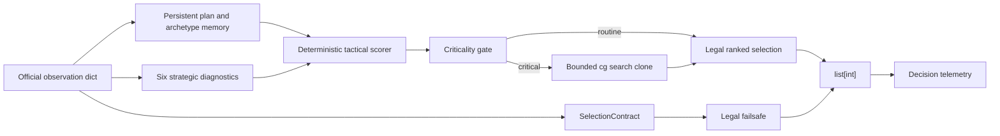

# Phase 6 architecture: official integration baseline and evidence loop

Phase 6 connects the research stack to the official **The Pokémon Company –
PTCG AI Battle Challenge Simulation** engine. It adds a self-contained
integration-baseline policy, bounded native look-ahead, deterministic packaging,
multidimensional evaluation, opponent/style panels, component ablations, and a
replay-review queue.

The heuristic policy and sampled-rollout advisor are **not** the intended final
strategic method. The target is the public-belief neural game-theoretic pipeline
specified in `PIVOT_TO_NEURAL_GAME_THEORETIC_PLANNING.md`. This document
describes the native integration that is preserved around that future planner.

It does not manufacture the two external results that are currently impossible:
the exact NAIC list cannot be expressed in the current Kaggle card pool because
Prism Tower is missing, and automated replay triage is not human expert review.

## Official boundary

The official engine calls `agent(obs_dict)` and requires:

- a 60-ID deck when `obs_dict["select"]` is `None`;
- otherwise, a `list[int]` of distinct option indices;
- every index in range; and
- selection length between `minCount` and `maxCount`.

`SelectionContract` validates this shape before every native-engine transition.
The competition safety boundary catches any policy/search failure and returns
the lowest-index legal selection. Failsafe use is retained in telemetry; it is
never silently counted as a successful policy decision.

The diagram above is the current executable integration baseline, not the target
neural game-theoretic architecture. Native `cg` transitions, observation/legal
options, selection validation, telemetry, and replays are genuine official-
engine execution. Phase 6G adds a production-disabled shadow path after the
baseline chooses: it allow-lists a one-decision public/private information-set
view, enumerates every legal ordered selection, round-trips the exact baseline
selection, and returns the original list unchanged. Phase 6A validates replay
redaction, and Phase 6B
validates tabular equilibrium/CFR and bounded re-solving on an exact abstract
microgame. Phase 6C validates two neural blueprints and exact checkpoint restore
on that same microgame. Phase 6D validates calibrated neural counterfactual-value
intervals and false-safety checks on disjoint exact-game roots. Phase 6E-F adds
an interruption-safe microgame resolver and separately certified synthetic
exploitation. Phase 6J now supplies a branchable full-game native-search
boundary under an explicitly supplied hidden-completion prior. Phase 6K trains
a small full-game sampled-regret candidate from terminal native branches, but
does not validate equilibrium convergence or improved play. Phase 6L replaces
its incorrect prospective sampling objective with an exactly audited external-
sampling MCCFR estimator on the non-official microgame. Phase 6M wires that
estimator and its separate memories to genuine native descendants only at five
immediate-terminal roots, producing zero advantages. Phase 6N validates a
linear-trajectory outcome-sampling MCCFR alternative, including nonzero
pre-action baseline correction, on the exact microgame. Phase 6O applies it to
a five-action persistent-plan game whose fixed tactical executor drives genuine
native descendants. Both-player regret memories, a separate average-strategy
memory, and three neural networks are populated, but transformed heavy-tailed
targets and an uncalibrated hidden prior prevent an equilibrium claim. A
validated full-game equilibrium blueprint, official resolver, and official exploitation overlay
remain unimplemented. The Phase 6G
one-step bridge does not transfer microgame evidence into official strategy
evidence.

Phase 6H adds an offline path from corrected official truth replays to logged
information-set trajectories. Common public history, private-observation hashes,
complete ordered legal actions, behavior labels, observed continuations,
terminal returns, and later-reveal supervision are separated structurally. The
native visualizer's next-frame `selected` field is shifted back to its source
prompt before validation. These logged continuations are genuine historical
engine transitions, but the derived corpus has abstract provenance and cannot
branch into unobserved actions.

Phase 6I consumes that corpus through train-only named normalizers and separate
public/private encoders. A ragged action head scores only each information
set's complete legal support, while public-range, terminal-outcome, and observed
next-public heads exercise future training seams. The action target is logged
heuristic behavior. This is a restorable representation bootstrap, not the
equilibrium blueprint or a native execution path.

Phase 6J reconstructs multiple simultaneous native search roots from one exact
agent observation and supplied hidden-zone particles. Descendant transitions
are genuine native search execution; the chance prior is not official. Search
IDs and selected truth stay in opaque solver state, while policies receive only
public belief, acting-player-private fingerprints, and complete ordered legal
actions. The interface reaches terminal games but does not train or deploy a
strategy.

Phase 6K adds a semantic, truth-free policy view aligned exactly to the Phase 6I
normalizers: 111 public, 75 own-private, and 11 per-action features. It copies
the Phase 6I encoders and fits distinct average-policy, action-advantage, and
state-value heads from terminal-valued legal-action branches. Its derived data
and model remain abstract; no selected hidden-completion ID enters policy
features. The one-rollout sampled-regret objective is not reach-corrected Deep
CFR, its held-out diagnostics are mixed, and the provider remains disabled in
the official action path.

Phase 6L expands every traverser action while sampling chance and opponent
actions, records conditional instantaneous advantages, and keeps average-
strategy samples separate from advantage samples. Exhaustive enumeration of
the exact microgame matches the reference advantages to floating-point
tolerance, and bounded traversal failures expose no partial dataset.

Phase 6M uses the same contracts against Phase 6J native states. Admission is
deliberately strict: every root action must immediately terminate, otherwise
the scenario is skipped. The admitted descendants are genuine licensed-engine
execution; hidden completions, fixed particles, behavior policy, semantic
features, and MCCFR samples remain research abstractions. The empty strategy
memory and zero-advantage samples make this an integration probe only.

Phase 6N samples one complete terminal history per traverser, maintains all
player/opponent/chance/sampling reach terms, and applies an audited pre-action
baseline correction. Every one of the exact microgame's 60 sample paths is
enumerated, with maximum expected-regret error `4.16e-17`. This is a scalable
estimator contract, not native execution.

Phase 6O makes the project's five persistent plans the abstract player actions
at native main-turn boundaries. A fixed plan-biased tactical policy resolves
procedural legal selections to chance, turn change, or terminal state. Those
descendant transitions genuinely execute native search; the plans, executor,
completion prior, features, samples, and neural strategy remain abstract. The
provider is production-disabled and refuses counterfactual-value access.

Phase 6P repeats collection and fitting for three rounds, with each new round
driven by the previous player-regret models. It proves the iterative seams and
separate average-strategy memory are executable. It also reveals that the
long-horizon importance tail worsens to p95 `5.04e11` and maximum `1.24e16`.
That failed variance gate prevents the model from entering counterfactual
calibration or safe resolving.

Phase 6Q encodes that rejection as a fingerprint-bound admission object. Only
native provenance, private-data redaction, and exact restoration pass; 13
data/variance/belief/held-out/value/equilibrium prerequisites fail. The gate
builds no bounds and calls no resolver or exploit overlay.

Phase 6R adds a generic depth-limited information-set boundary. Exact
continuation leaves preserve 18 pre-cutoff regret expectations to `5.55e-17`
on the non-official microgame. The live six-step probe executes 1,474 genuine
native tactical descendants, but all 36 trajectories terminate at abstract
cutoff leaves. Clamped values and baselines reduce the observed raw-regret p95
and maximum to `17.90` and `134.92`; the leaves remain confidence-zero,
full-range, and uncalibrated, so the samples cannot enter safety admission.

Phase 6S adds evaluation-only hidden-order particles and repeated terminal
continuations. The native descendants are genuine, while cutoff states,
particles, plan policy, and empirical fixed-profile return targets remain
abstract. Its nominal 100% validation coverage is vacuous because every
interval has full utility width; the static public range also matches the
uniform baseline exactly. No belief/value capability flag changes.

Phase 6T resamples allocation between hidden zones and routes native public
observations through the public-only Phase 6I range head. Its 72 held-out rows
reject direct neural transfer: NLL `1.8109` is worse than uniform `1.7918` and
causal revealed-card NLL `0.8959`. The native observations are genuine; the
allocation particles, range model, labels, and calibration decision remain
abstractions. The causal updater becomes the next baseline, while belief and
safety capability flags stay false.

Phase 6U raises every allocation-heldout cutoff target to ten terminal
continuations and calibration-selects among the Phase 6I value head, Phase 6K
scalar, and zero. The maximum rollout standard error falls below threshold, but
zero wins and the interval stays full-width. The remaining value blocker is
model bias/representation rather than target sampling precision.

Phase 6V fits a public-only ridge scalar directly to the low-noise Phase 6U
targets with leave-one-candidate-out training selection, then freezes it before
a separate native allocation run. The scalar beats the three reference point
predictors on fresh validation, but its 90% interval is nearly the full utility
range. It remains a research artifact outside the resolver and official control
path.

Phase 6W isolates complete native collections for training, conformal
calibration, and validation. Pairwise particle, cutoff-state, and public-history
overlap is zero. The untouched collection rejects the ridge both against zero
and on interval width, so it remains outside every strategic execution path.

Phase 6X introduces a hypothesis-by-opponent-plan value surface. Every supplied
hidden allocation reaches a player-1 decision, branches the five abstract plans,
and receives ten paired average-blueprint continuations. The output is useful
conditional action supervision, but it lacks opponent/chance reach weighting
and therefore does not implement the counterfactual-value interface.

Phase 6Y adds a target-player-excluding reach ledger and validates its
importance-ratio expectation on every exact-microgame information-set/action
row. The fresh native run binds a redacted ledger to every Phase 6X-style
surface. All native roots are already at the first opponent plan decision, so
the strategic prefix is empty and the weight is one. Because no public
information set has repeated hidden hypotheses and the prior remains supplied,
the ledger is not a native counterfactual-value provider.

Phase 6Z captures later exact battle observations and constructs three
zero-substitution hidden allocations behind each shared public root. Entire
root families are isolated across train, calibration, and validation before a
hypothesis-and-action-conditioned ridge diagnostic is fit. This repairs the
one-root-per-particle data shape. The model itself is rejected on untouched
roots (`75.56%` coverage and `0.847985` RMSE versus zero `0.771402`), and the
game-theoretic semantics remain incomplete: the acting player's observed hand
is fixed, the particle prior is supplied, and upstream official reach is
unavailable. Conditional-model diagnostics therefore cannot populate
counterfactual bounds or enter the resolver.

Phase 6AA consumes only the frozen Phase 6Z public roots and fits a six-class
prototype range. Candidate truth is supervision only; prediction emits the
existing `OpponentRange` interface from public features. Held-out archetype
signal beats uniform, but root-count gates, ECE, hidden-resource scope, and the
observer-orientation bridge fail. The artifact is an offline range diagnostic,
not an official public-belief provider.

Phase 6AB collects a separate official behavior prefix for every split and
candidate. Every deterministic player selection from battle start to the later
root is contract-valid, genuinely executed, and linked by redacted public-state
and public-history digests. This supplies exact declared player-policy reach,
but not official chance reach: the live adapter advances automatic shuffle,
Prize, draw, and coin events without exposing their probabilities. Full reach,
counterfactual weights, and alignment to the independent Phase 6Z value roots
therefore remain unavailable.

Phase 6AC replaces that independent-root shape with a fresh joint collector.
At each of 18 live later roots, the callback retains the full redacted prefix,
uses visualizer truth only long enough to reconstruct the exact native state,
validates complete root and forced-next-draw public/private parity, and branches
all five plan actions into terminal continuations. Target and sampling use the
same opaque official chance process, so `CommonChanceLawReachRatio` records its
pointwise cancellation without inventing absolute chance reach. With only one
truth sample per information set and three noisy continuations per action, the
result is a collection/replay substrate rather than a calibrated
counterfactual-value provider.

Phase 6AD runs a separate, larger official truth collection at the same later-
root boundary. It explicitly reorients the player-1 prompt to a player-0 public
view, gathers 180 roots with disjoint 60-root train/calibration/validation
splits, and draws 32 public-consistent allocations for every candidate/root
pair. The resulting six-list candidate and 96-bucket hidden hand/Prize/deck
range passes preregistered held-out gates. The official roots and transient
truth labels are genuine; the observer adapter, exact-list catalog, prototypes,
allocation prior, and posterior interpretation remain abstract. No value,
resolver, exploitation, or strategy-control gate opens.

Phase 6AE collects a separate 324-root panel that fixes player 0's policy and
varies only player 1 over six declared intent proxies crossed with the six deck
candidates. Its model sees player-0 public root scalars and coarse public
player-1 MAIN action sequences only. A train-only linear intent component is
calibrated separately and multiplied by the frozen Phase 6AD candidate/resource
range to form 36 hypotheses. Held-out proxy and joint gates pass, but the
policies, intent labels, independence assumption, and model are abstractions;
human latent intent, full belief, values, safety, exploitation, and control
remain unavailable.

Phase 6AF treats policy implementation as a held-out nuisance variable. Two
player-1 implementations supply training domains, a third supplies calibration,
and a fourth is untouched validation. Leave-one-policy-out training selection
uses no variant identifier or validation root. The 36-hypothesis joint range
passes aggregate and per-intent transfer gates, but all implementations remain
authored abstractions; latent human intent, values, bounds, resolving,
exploitation, and control stay unavailable.

Phase 6AG completes the official games instead of treating sampled native
rollouts as its value target. A 208-input neural leaf trains on two policy
implementations, selects and calibrates on disjoint halves of a third, and is
evaluated on an untouched fourth. Its on-policy terminal-outcome point MSE
beats both preregistered baselines, but its progress-bucket intervals fail
coverage and width. The provider is offline and production-disabled; it is not
a counterfactual-value provider, equilibrium blueprint, resolver input, or
official action controller.

```mermaid
flowchart LR
    O["Official observation"] --> D["Preserved baseline decision"]
    D --> R["Exact native selection returned unchanged"]
    O --> B["Phase 6G allow-listed one-step bridge"]
    D --> B
    B --> A["Redaction and action-lifting audit only"]
    A -. "no strategy control" .-> R
    O --> T["Corrected Phase 6H logged trajectories"]
    T --> D2["Offline representation/belief/value training data"]
    D2 --> N0["Phase 6I logged neural bootstrap"]
    O --> G2["Phase 6J supplied hidden-completion chance root"]
    G2 --> NG["Branchable native search transitions"]
    N0 --> K["Phase 6K sampled-regret candidate"]
    NG --> K
    K --> L["Phase 6L exact estimator reference"]
    NG --> M["Phase 6M immediate-terminal wiring"]
    L --> M
    L --> N["Phase 6N outcome-sampling reference"]
    NG --> O["Phase 6O native turn-plan candidate"]
    N --> O
    M -. "zero regrets" .-> O
    O --> P["Phase 6P iterative loop"]
    P --> Q["Phase 6Q safety admission"]
    P --> V["Phase 6R depth-limited variance probe"]
    V -. "uncalibrated leaf; admission unchanged" .-> Q
    V --> S["Phase 6S held-out leaf/range diagnostic"]
    S -. "vacuous interval and uniform range" .-> Q
    G2 --> BT["Phase 6T hidden-allocation range diagnostic"]
    N0 --> BT
    BT -. "neural rejected; causal baseline only" .-> Q
    V --> U["Phase 6U low-noise leaf comparison"]
    BT --> U
    U -. "precision passes; model/interval fails" .-> Q
    U --> PV["Phase 6V purpose-trained public leaf"]
    BT --> PV
    PV -. "point RMSE improves; interval still vacuous" .-> Q
    PV --> W["Phase 6W collection-heldout audit"]
    W -. "point gain does not generalize" .-> Q
    W --> X["Phase 6X opponent deviation surfaces"]
    X --> Y["Phase 6Y counterfactual-reach ledger"]
    Y --> Z["Phase 6Z public-root-aligned values"]
    Z -. "conditional model only; prior/hand/reach incomplete" .-> Q
    Z --> AA["Phase 6AA public-archetype range"]
    AA -. "signal only; posterior scope/calibration incomplete" .-> Q
    Z --> AB["Phase 6AB fresh official behavior prefixes"]
    AB --> AC["Phase 6AC joint official truth/value samples"]
    NG --> AC
    AC -. "one truth sample; absolute chance reach unavailable" .-> Q
    AC --> AD["Phase 6AD observer-oriented hidden-card range"]
    AD --> AE["Phase 6AE seat-decoupled intent-proxy range"]
    AE --> AF["Phase 6AF implementation-heldout intent families"]
    AF --> AG["Phase 6AG full-game neural point-value leaf"]
    AG -. "point gate passes; interval/value/safety gates fail" .-> Q
    Q -. "rejected; no bounds/resolver/strategy control" .-> R
```

## Exact deck and compatibility profile

The immutable research deck remains the exact Juho Kallama NAIC 2026 list.
Pokémon's official event page identifies its two Stadiums as **Prism Tower CRI
80**. The Kaggle engine snapshot dated 2026-07-15 exposes 1,267 IDs in the
TEF–POR pool; it contains no Prism Tower.

`resolve_official_deck()` therefore returns 58 resolved IDs plus the unresolved
name and fails closed when `fail_on_unresolved=True`. It never changes the deck.

For local integration only, callers may explicitly pass
`KAGGLE_WATCHTOWER_SUBSTITUTION`, replacing the two Prism Tower slots with Team
Rocket's Watchtower. That profile is always labelled
`rocket_mewtwo_watchtower_compatibility`, carries the source-deck and resolution
fingerprints, and reports `exact=False`. It is not evidence about the exact
deck.

Sources:

- [Official NAIC 2026 Masters deck page](https://www.pokemon.com/uk/play-pokemon/internationals/2026/north-america/tcg-masters)
- [Official Kaggle competition](https://www.kaggle.com/competitions/pokemon-tcg-ai-battle)
- [Official Kaggle rules](https://www.kaggle.com/competitions/pokemon-tcg-ai-battle/rules)

## Integration-baseline policy

The flat competition policy uses only the Python standard library. It carries:

- persistent plans: board setup, energy engine, prize push, recovery, control;
- six values: setup, tempo, resource efficiency, prize control, board control,
  optionality;
- state-conditioned convex weights over those values;
- an eight-archetype posterior updated only from public/revealed cards;
- exact option/card/target resolution for official option schemas;
- Team Rocket-specific setup, search, discard, attachment, evolution, retreat,
  gust, attack, and lethal heuristics;
- a soft decision budget and complete per-decision telemetry.

The live policy is an executable baseline boundary, not a claim that the full
PyTorch research model has been trained on official trajectories and not the
future game-theoretic blueprint. Its stable legality/telemetry interfaces are
intended to remain while the strategic provider is replaced after training and
bridge validation.

## Bounded native look-ahead

`OfficialCgSearchAdvisor` imports `cg.api` only inside the competition runtime.
For one-card decisions the baseline advisor:

1. constructs deterministic hidden-zone completions without treating them as
   facts;
2. calls `search_begin` with the untouched agent observation;
3. clones up to six policy candidates;
4. performs a short, deadline-limited rollout;
5. scores terminal result, Prize cards, HP, board, Energy, and hand resources;
6. releases every search state and returns advisory value bonuses.

Any import, completion, or native-search error returns no advice. The base legal
policy remains valid. Search is an advisory tactical validator and baseline
only. Neither it nor the Phase 3 plan search supplies an equilibrium blueprint
or certified opponent counterfactual-value bounds.

The current baseline archive's search prior is the official sample Abomasnow deck. This is a
known robustness weakness when the opposing archetype differs.

## Evaluation design

The checked-in official benchmark has 144 matches:

- four ablations: policy only, strategic, belief + strategic, full;
- six archetypes: official sample Abomasnow, Alakazam, Starmie, Dragapult,
  Crustle, and the Rocket compatibility mirror;
- three styles: tempo, attack rush, and control;
- both player seats.

Abomasnow is the official sample deck. The other non-Rocket lists are legal,
deterministic archetype probes—not tournament-optimized expert agents. This
distinction is part of the evidence report.

Every match records:

- tactical action counts, legality, fallback, timeout, attack timing, and static
  lethal conversion;
- the six strategic values and weights, Prize margin, board, hand, and
  optionality;
- archetype-posterior NLL and Brier score against the known panel label;
- search invocations, action changes, and advice value;
- per-archetype, style, seat, and ablation outcomes;
- native replay data for an automatically triaged expert-review queue.

The native battle API provides no match-seed control, so shuffled games cannot
be exactly paired across ablations. Confidence intervals and this limitation
are both reported.

## Replays and expert review

`review_official_replay` parses the engine's truth-level visualizer frames and
flags terminal loss, slow/four-Rocket setup, missed static lethal, low
optionality, high belief entropy, and unproductive search. Each review contains
a fixed expert rubric covering setup, sequencing, Energy economy, retreat/gust,
Prize map, liabilities, optionality, beliefs, and search.

Automated triage selects what a human should review. Its status remains
`pending`; it cannot satisfy the roadmap's expert-review requirement by itself.

## Conditional plan-value research boundary

Phase 6AH-6AM reuse the preserved native adapter to collect complete matches,
retain exact engine snapshots, force five abstract turn plans behind supplied
public-consistent hidden allocations, and run paired terminal descendants.
Those matches, selections, snapshot restores, immediate branches, and native
descendants are genuine official-engine execution. The allocation prior,
five-plan game, tactical executor, continuation policy, learned values,
heuristics, bootstrap, and intervals are research abstractions.

Phase 6AI adds immediate public-only child deltas and rejects its grouped
learned action advantage. Phase 6AJ freezes a neural-mean/causal-branch hybrid
and interval radius before a new 36-root panel. The fresh point and contrast
gates pass; interval width fails. The resulting provider is therefore a scoped
offline point diagnostic only, not a blueprint strategy, opponent
counterfactual-value bound, safe-resolver input, exploitation signal, or
official controller.

Phase 6AK treats the Phase 6AI and Phase 6AJ roots as a declared development
corpus, then freezes a regularized residual ridge state mean before collecting
separate 36-root calibration and validation panels in that order. The fresh
point model beats the Phase 6AJ hybrid and every nonlearned baseline. Aggregate
coverage and width pass, but the preregistered worst-slice coverage gate fails.
It remains a collection-heldout offline point diagnostic. It is not an
implementation-heldout result, conditional expected-mean admission,
counterfactual-value provider, or official strategy component.

Phase 6AL freezes the exact Phase 6AK mean and adds a second independent replay
batch per root, giving 32 returns for each action. Its 36-root calibration panel
is serialized before the disjoint 36-root validation panel starts. Sampling
precision passes and point MSE beats every frozen reference, but the
preregistered contrast bootstrap, aggregate coverage, and worst-slice coverage
gates fail. It therefore rejects point and conditional-mean promotion and keeps
all counterfactual, equilibrium, resolver, exploitation, and control paths
disabled. The experiment shows that reducing target noise alone does not close
the value-model gap.

Phase 6AM stops extending the learned absolute-mean sequence. It freezes a
baseline-relative causal branch center and conformal radius from the complete
Phase 6AI-6AL development ledger, joins them to the frozen Phase 6AD public
candidate/resource range, and evaluates 180 normalized action-advantage targets
on 36 new roots. Coverage, slice, width, bootstrap, range, reach, and holdout
gates pass. Maximum target SE `0.201688` exceeds the frozen `0.20` ceiling, so
the 6-hypothesis x 5-action bound matrix remains inspection-only and cannot feed
the safe resolver. This is the intended architectural direction—public belief,
blueprint-relative counterfactual bounds, then safe resolving—but not an
admission of absolute counterfactual values, equilibrium convergence,
exploitation, or official control.

## Modules

| Module | Responsibility |
|---|---|
| `competition.py` | Exact/proxy deck resolution, official contract, policy, plan/belief/value memory, safety and telemetry |
| `competition_search.py` | Lazy official native search and deterministic hidden completion |
| `official_evaluation.py` | Legal decks, opponent styles, engine runner, match evidence |
| `evaluation.py` | Metrics, confidence intervals, slices, claim boundary, JSON/Markdown report |
| `replay_review.py` | Automated replay triage and human-review rubric |
| `phase6_demo.py` | Reproducible official 144-match matrix |
| `game_theory.py` | Public-belief, information-set, blueprint, safe-resolve, and constrained-exploitation contracts/stubs |
| `public_replay.py` | Perspective-isolated truth-replay conversion, later-reveal labels, and leakage audit |
| `official_trajectory.py` | Corrected logged information sets, public-only range baseline, causal transition/return labels, and serialization |
| `trajectory_neural.py` | Split-safe logged-data encoder, ragged legal-action imitation head, auxiliary heads, and restorable checkpoint |
| `official_search_game.py` | Opaque supplied hidden particles, native branch roots, information sets, chance, transitions, and terminal utility |
| `native_blueprint_features.py` | Phase 6I-compatible public/own-private/action tensors with no selected-truth input |
| `native_regret_blueprint.py` | Restorable average-policy/advantage/value candidate trained from sampled native regrets |
| `external_sampling.py` | Bounded external-sampling traversal plus separate deterministic advantage and strategy reservoirs |
| `mccfr_reference.py` | Exhaustive expectation audit and tabular external-sampling MCCFR reference on the exact game |
| `exact_game.py` | Exact abstract tree, analytic equilibrium, best responses, CFR, and bounded microgame resolver |
| `phase6_foundation.py` | Deterministic Phase 6A-6B evidence assembly |
| `neural_blueprint.py` | Deterministic microgame policy/regret networks, provider, artifact, and restoration |
| `phase6_neural.py` | Phase 6C training, exact comparison, round-trip validation, and evidence assembly |
| `counterfactual_calibration.py` | Phase 6D residual calibration, uncertainty widening/gates, and exact false-safety audit |
| `phase6_bounds.py` | Deterministic Phase 6D evidence assembly |
| `safe_resolving.py` | Phase 6E all-or-blueprint budget/deadline-safe exact resolver and pipeline |
| `phase6_resolving.py` | Deterministic Phase 6E exact resolver evidence |
| `opponent_exploitation.py` | Phase 6F separate synthetic models and exact all-pure final certificate |
| `phase6_exploitation.py` | Deterministic Phase 6F adversarial exploitation evidence |
| `official_bridge.py` | One-step official public/private boundary, complete ordered action lifting, and transparent shadow wrapper |
| `phase6_bridge.py` | Live Phase 6G official-engine bridge audit and evidence assembly |
| `phase6_trajectory.py` | Deterministic Phase 6H offline trajectory-substrate evidence |
| `phase6_trajectory_neural.py` | Deterministic Phase 6I logged neural-bootstrap evidence |
| `phase6_native_game.py` | Live Phase 6J branchable native-search-game evidence |
| `phase6_native_blueprint.py` | Live Phase 6K terminal-branch collection, training, restoration, and scoped evidence |
| `phase6_mccfr_reference.py` | Deterministic Phase 6L estimator and convergence-reference evidence |
| `phase6_native_external_sampling.py` | Live Phase 6M immediate-terminal native wiring and redacted reservoir evidence |
| `outcome_sampling.py` | One-trajectory MCCFR traversal, pre-action baseline correction, and separate bounded memories |
| `outcome_sampling_reference.py` | Exhaustive nonzero-baseline audit and tabular outcome-sampling reference |
| `phase6_outcome_sampling_reference.py` | Deterministic Phase 6N exact-game evidence |
| `native_plan_game.py` | Five-plan turn abstraction with fixed legal executor over genuine native descendants |
| `native_plan_blueprint.py` | Separate player-regret and average-plan neural models with fail-closed capability flags |
| `phase6_native_plan_blueprint.py` | Live Phase 6O collection, training, restoration, and scoped evidence |
| `phase6_native_plan_iterations.py` | Live Phase 6P collect–fit–update loop and failed variance-gate evidence |
| `native_plan_safety_admission.py` | Fingerprint-bound necessary-prerequisite guard that enables nothing on rejection |
| `phase6_native_safety_admission.py` | Deterministic Phase 6Q rejection evidence |
| `depth_limited_game.py` | Generic cutoff boundary plus exact/typed leaf-value contract |
| `native_plan_leaf.py` | Confidence-zero, full-range native leaf adapter for diagnostics only |
| `phase6_native_depth_limited.py` | Phase 6R exact cutoff audit and live bounded-horizon evidence |
| `phase6_native_leaf_calibration.py` | Phase 6S disjoint order-particle continuation and calibration rejection evidence |
| `native_public_range.py` | Public-only Phase 6I range adapter with causal revealed-card features and no truth/private input |
| `phase6_native_belief_calibration.py` | Phase 6T hidden-allocation native range evaluation and fail-closed evidence |
| `phase6_native_leaf_model.py` | Phase 6U ten-rollout allocation-heldout value comparison and model-bias rejection |
| `native_public_leaf.py` | Split-safe public-only ridge leaf model and restorable artifact |
| `phase6_native_public_leaf.py` | Phase 6V fresh native calibration/validation and fail-closed evidence |
| `phase6_root_heldout_leaf.py` | Phase 6W three-collection generalization audit and fail-closed evidence |
| `phase6_opponent_deviation_values.py` | Phase 6X hypothesis/action conditional-return collection; explicitly non-counterfactual |
| `counterfactual_reach.py` | Target-player-excluding importance ratio, redacted prefix trace, and exact expectation audit |
| `phase6_native_counterfactual_reach.py` | Phase 6Y native reach-ledger collection and fail-closed admission evidence |
| `phase6_aligned_counterfactual_values.py` | Phase 6Z later-root-aligned native values, split-safe diagnostic model, and fail-closed calibration |
| `phase6_aligned_public_range.py` | Phase 6AA train/calibration/validation public-archetype range diagnostic and fail-closed admission |
| `phase6_official_prefix_reach.py` | Phase 6AB genuine redacted selection-prefix ledger with explicit missing chance/full reach |
| `phase6_joint_official_values.py` | Phase 6AC same-root official prefix/truth/value collection, native replay-fidelity gate, and fail-closed evidence |
| `phase6_official_range_calibration.py` | Phase 6AD 180-root observer-oriented official truth collection, public-only candidate/resource calibration, and fail-closed downstream gates |
| `phase6_official_intent_calibration.py` | Phase 6AE 324-root seat-decoupled controlled-policy collection, public-action intent calibration, 36-hypothesis joint range, and fail-closed latent/downstream gates |
| `phase6_official_policy_generalization.py` | Phase 6AF 432-root four-implementation transfer panel, leave-one-policy-out robust calibration, per-intent gates, and fail-closed latent/downstream claims |
| `phase6_official_value_leaf.py` | Phase 6AG 288-match full-game neural point leaf, implementation-heldout calibration, rejected expected-value intervals, and fail-closed downstream claims |
| `phase6_expected_value_surfaces.py` | Phase 6AH repeated root/action sampling, expected-mean diagnostic, and rejected action/interval gates |
| `phase6_branch_conditioned_values.py` | Phase 6AI immediate public branch observations, grouped action-value diagnostic, and fail-closed rejection |
| `phase6_semiparametric_branch_hybrid.py` | Phase 6AJ frozen semiparametric point hybrid, fresh validation, interval rejection, and downstream fail-closed evidence |
| `phase6_expanded_root_mean.py` | Phase 6AK expanded regularized root mean, sequential fresh calibration/validation, scoped point validation, worst-slice interval rejection, and downstream fail-closed evidence |
| `phase6_high_precision_confirmation.py` | Phase 6AL frozen-mean, two-batch/32-return confirmation, sequential calibration/validation, bootstrap and coverage rejection, and downstream fail-closed evidence |
| `phase6_public_range_counterfactual_advantages.py` | Phase 6AM frozen public-range, baseline-relative normalized advantage bounds, fresh held-out precision/coverage audit, and fail-closed rejection |
| `scripts/build_submission.py` | Fail-closed, deterministic baseline-only `.tar.gz` packaging |

## Runtime and license boundary

The `cg` engine is competition-use-only, is not imported by the research package
at module import time, and is staged under `work/official_kaggle`. Do not
redistribute it, use it outside this competition, or retain it after the
competition ends. The binding terms are the official Kaggle rules and the
license shipped with the engine.
